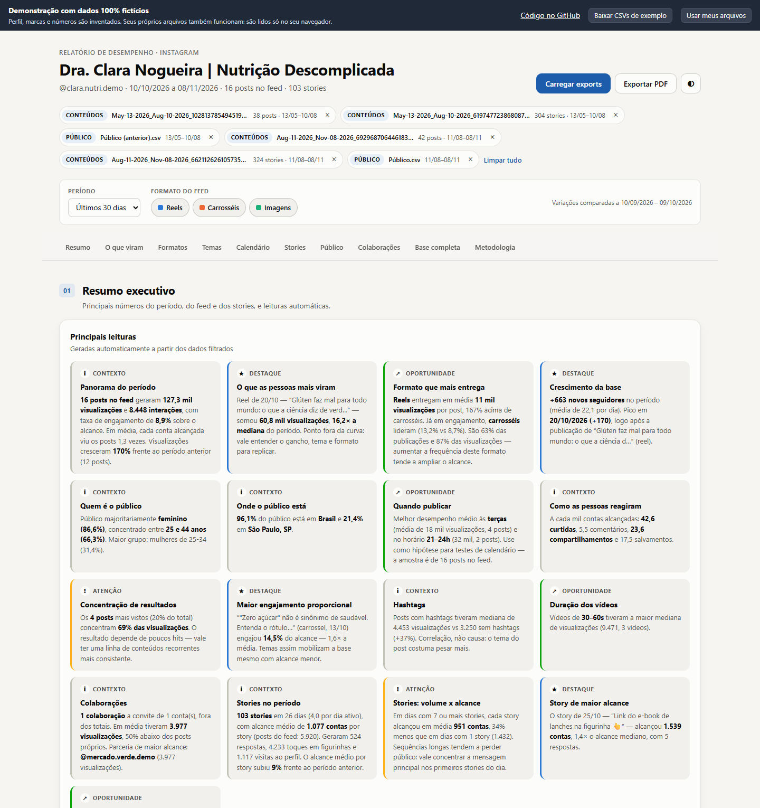
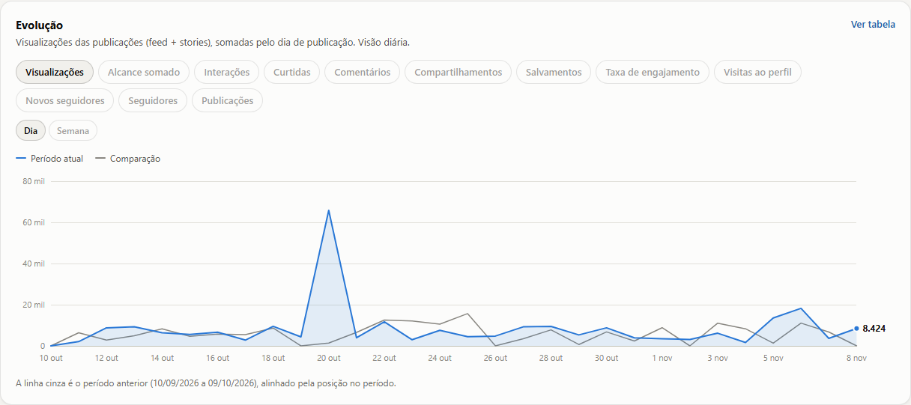
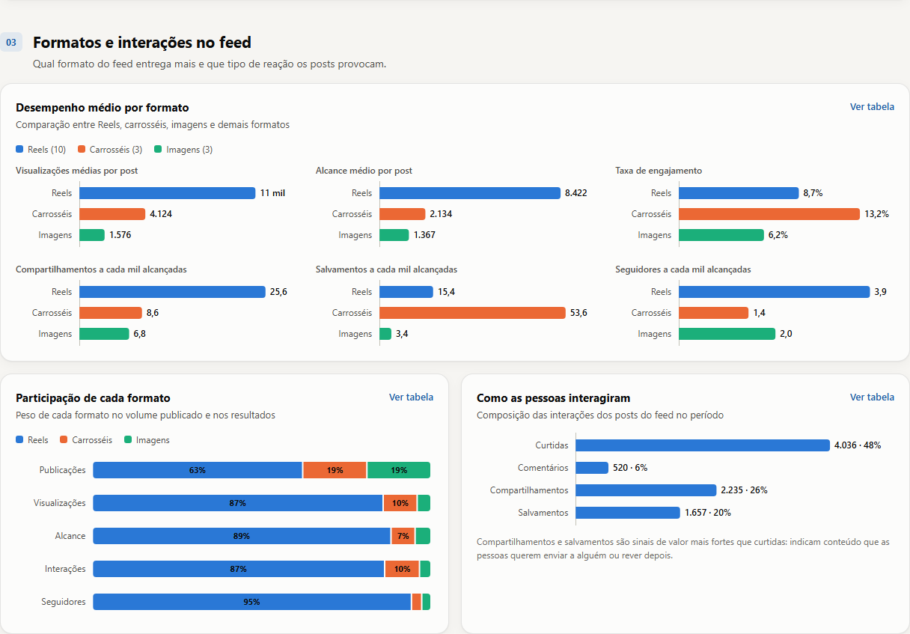
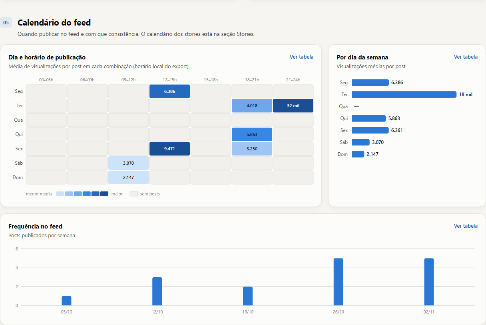
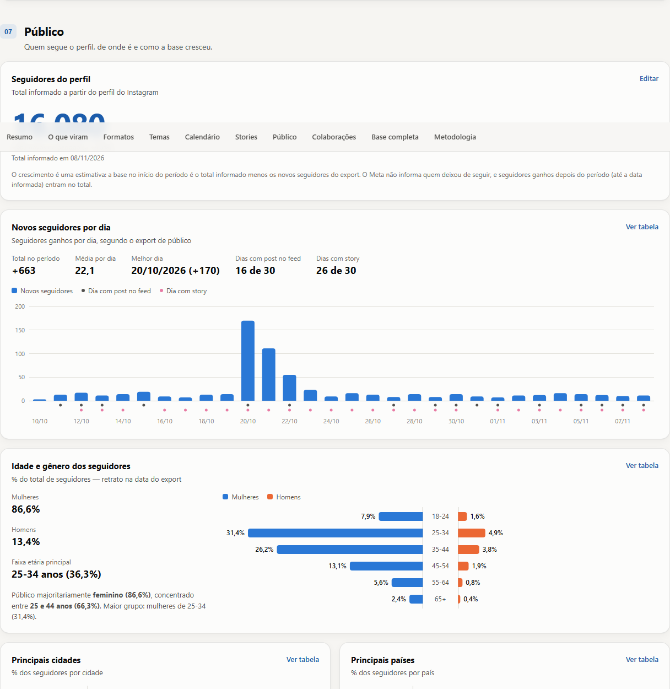
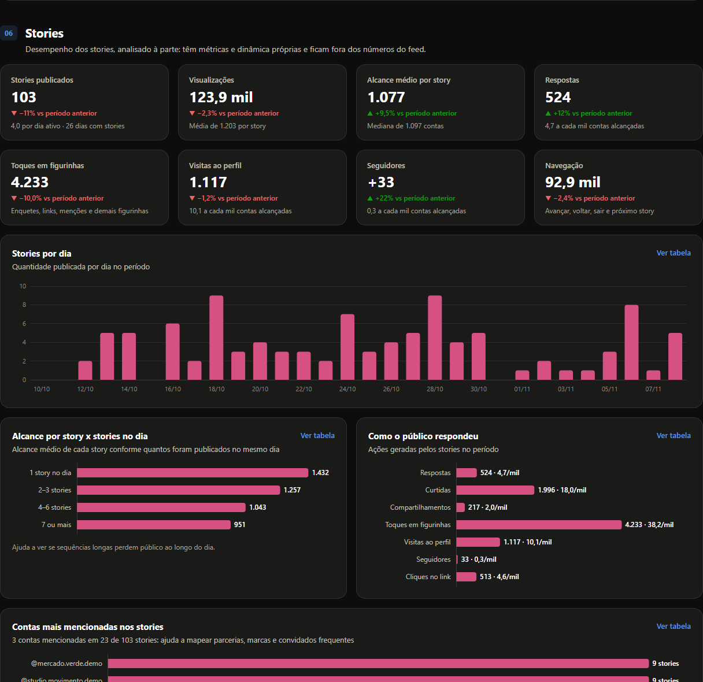
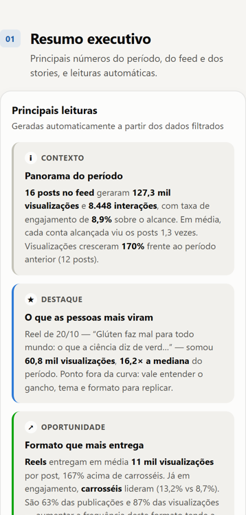

# Painel de Desempenho no Instagram

Relatório de desempenho no Instagram gerado a partir dos exports CSV do **Meta Business Suite**: feed, stories, público e colaborações, com comparação com o período anterior, leituras automáticas e exportação em PDF. Feito em HTML, CSS e JavaScript puro, sem dependências e sem build. Os arquivos são processados no próprio navegador.

**[▶ Abrir a demonstração](https://lucaselpidio.github.io/painel-desempenho-instagram/)** · roda no navegador, sem instalar nada. Também aceita os seus próprios exports do Meta, que não saem do seu computador.

> **Todos os dados da demonstração são fictícios.** O perfil (@clara.nutri.demo), as marcas parceiras e os números foram inventados. O projeto foi construído para uso real com perfis de clientes; esta é a versão pública, sem nenhum dado deles.



---

## O problema

O Meta Business Suite exporta os dados do Instagram em CSVs crus: uma linha por publicação, com o total acumulado de cada métrica. Transformar isso num relatório para a cliente era trabalho manual, e alguns pontos levavam a leituras erradas:

- feed e stories vêm no mesmo tipo de arquivo, mas têm métricas e dinâmicas diferentes, e somá-los distorce as médias;
- o export traz também os posts de **outras contas** em que a cliente entrou como colaboradora, com métricas compartilhadas;
- cada export cobre no máximo 90 dias, e exports sobrepostos repetem as mesmas publicações;
- o export de público vem em outra codificação (UTF-16), e o **total de seguidores** não aparece em nenhum arquivo;
- nada é comparado com o período anterior.

## O que o relatório responde

| Pergunta | Onde |
|---|---|
| Como foi o período, comparado com o anterior? | **Resumo executivo**: indicadores de feed e stories com variação e leituras automáticas (destaques, oportunidades e pontos de atenção) |
| O que as pessoas mais viram, e com que profundidade? | **O que viram**: ranking de posts, visualizações por post contra a mediana e revisualização (visualizações ÷ alcance) |
| Qual formato entrega mais? | **Formatos**: Reels × carrosséis × imagens em alcance, engajamento, salvamentos e seguidores a cada mil contas |
| Sobre o que falar? | **Temas**: termos e hashtags dos posts mais vistos, duração dos vídeos e tamanho da legenda |
| Quando publicar? | **Calendário**: mapa de calor dia × horário e frequência semanal |
| Os stories estão funcionando? | **Stories**: alcance por story conforme o volume do dia, figurinhas, links, menções e mapa de horários |
| Quem é o público e como a base cresce? | **Público**: novos seguidores por dia (com os dias de publicação marcados), idade × gênero, cidades e países |
| As parcerias valem a pena? | **Colaborações**: collabs comparadas com os posts próprios, por parceiro |

Todo gráfico tem **Ver tabela**, e há três gráficos de **Evolução** (resumo, feed e stories) com a linha do período anterior.

| | |
|---|---|
|  |  |
|  |  |
|  |  |

## Regras de dados que fazem diferença

- **Vários exports viram uma base só.** Os posts são unidos pelo ID. Quando o mesmo post aparece em mais de um export, vale a versão com mais visualizações, porque métricas vitalícias só crescem.
- **O tipo de cada arquivo é detectado pelo conteúdo**, não pelo nome: cabeçalhos em português ou inglês, separador `,` ou `;`, UTF-8 ou UTF-16, datas `MM/DD` ou `DD/MM` (detectado quando o dia passa de 12).
- **Feed e stories ficam separados.** Stories têm seção própria e não entram nas médias do feed.
- **Collabs ficam fora dos totais**, porque as métricas são compartilhadas entre as contas. Têm seção própria, comparadas com os posts próprios.
- **Alcance não é somável entre canais**: a mesma pessoa pode ter visto o feed e os stories. O relatório deixa isso explícito em vez de somar.
- **Mediana, não média, como referência** ("3,1× a mediana"), para um único viral não distorcer a comparação. O mapa de calor usa passos por quantil pelo mesmo motivo.
- **Seguidores do perfil:** o total é informado à mão (o export não traz) e o crescimento do período é estimado a partir dele, com a ressalva explicada na metodologia.
- **Leituras automáticas** são regras determinísticas sobre os dados filtrados. Elas apontam hipóteses ("correlação, não causa") e citam o tamanho da amostra.

## Envio do PDF a um hub de relatórios

O botão **Exportar PDF** imprime o relatório com layout próprio de impressão e, na versão de produção, envia uma cópia em PDF à API de um hub de relatórios, onde a cliente recebe o relatório. Nesta versão pública o hub é **fictício** (`hub.example.com`) e, na demonstração, o botão só imprime.

```
navegador (botão)  ──POST multipart──►  servidor/hub-relatorios.js  ──POST multipart + Bearer──►  API do hub
sem segredo                             segredo só em variável de ambiente
```

- O **segredo da API nunca vai ao navegador**: um servidor Node.js sem dependências guarda o segredo e repassa o PDF.
- O envio é **idempotente**: o `id_externo` é um hash do recorte do relatório. Reenviar o mesmo relatório não duplica nada, e um relatório corrigido gera um id novo.
- O servidor só aceita chamadas do próprio relatório (cabeçalho próprio + verificação de origem) e limita tamanho e tempo de resposta.

Detalhes em [EXPORTAR-PDF.md](EXPORTAR-PDF.md). O passo a passo escrito para quem usa o relatório no dia a dia está em [guia.md](guia.md).

## Como foi construído

- **JavaScript puro, sem dependências e sem build**, em scripts clássicos para funcionar até aberto via `file://`. Módulos separados para leitura dos CSVs ([parsers.js](assets/js/parsers.js)), cálculos ([metrics.js](assets/js/metrics.js)), leituras automáticas ([insights.js](assets/js/insights.js)), gráficos SVG próprios ([charts.js](assets/js/charts.js)) e interface ([app.js](assets/js/app.js)).
- **Feito para ser embutido** numa plataforma: classes, IDs e variáveis CSS com prefixo `igr`, seções opcionais (o relatório desenha só as que existem no HTML) e uma API (`IGR.app.init`, `loadText`, `getModel`…) para alimentar os dados por código. Veja [INTEGRACAO.md](INTEGRACAO.md).
- **Identidade visual num arquivo só** ([tokens.css](assets/css/tokens.css)), com tema claro e escuro e uma paleta de séries validada para daltonismo.
- **Segurança:** textos dos CSVs entram sempre como texto (nunca como HTML), links só `http`/`https` e o CSV exportado neutraliza fórmulas (`=`, `+`, `-`, `@`).

## Testes

```bash
node tests/teste-evolucao.node.js          # séries dos gráficos de evolução
node tests/teste-linhas.node.js            # desenho do gráfico de linhas
node tests/teste-evolucao-limites.node.js  # casos-limite: datas, fusos, dados estranhos, valores extremos
TZ=Asia/Tokyo node tests/teste-evolucao-limites.node.js   # o mesmo, em outro fuso horário

python -m http.server 8000                 # depois abra http://localhost:8000/tests/
```

São **198 verificações em Node** (os casos-limite passam em 7 fusos horários, de Los Angeles a Sydney) e **110 verificações em 16 cenários no navegador**: os três exports reais do Meta, collabs e stories, filtros, variações de arquivo, segurança (HTML e links maliciosos, fórmulas no CSV), isolamento do tema, gráficos sem texto cortado no desktop e no celular, seções opcionais e volume grande. Todas passam em Chromium, Firefox e WebKit. As fixtures da pasta [tests/fixtures](tests/fixtures/) são fictícias.

## Os dados fictícios

O arquivo [demo/dados-demo.js](demo/dados-demo.js) gera os mesmos arquivos que o Meta exporta (mesmas colunas, formato de data e codificação) para uma nutricionista fictícia: feed e stories em duas janelas de 90 dias, como quem exporta duas vezes, e o público de cada janela. A demonstração carrega esses arquivos pelo mesmo leitor usado com exports reais.

- **As datas são relativas a hoje**, para os filtros nunca ficarem vazios, e a mesma data gera sempre os mesmos arquivos (aleatoriedade com semente).
- **Os dados contam uma história:** Reels alcançam mais e carrosséis são mais salvos; rótulos e mitos são os temas fortes; terças e quintas à noite são os melhores horários; um reel viraliza e puxa um pico de seguidores; 12 dias de férias sem posts; sequências longas de stories perdem alcance; collabs com marcas parceiras.

Para validar o gerador com o leitor real do relatório e gravar os CSVs:

```bash
node scripts/exportar-dados.mjs              # data de referência: hoje
node scripts/exportar-dados.mjs 2026-11-09   # outra data
```

Uma exportação pronta está em [dados-ficticios/](dados-ficticios/). Na demonstração, o botão **Baixar CSVs de exemplo** baixa os arquivos do dia.

## Rodar localmente

Abra o `index.html` no navegador, ou sirva a pasta com qualquer servidor estático (`npx serve .`, `python -m http.server`). Para testar o envio ao hub, veja [EXPORTAR-PDF.md](EXPORTAR-PDF.md).

## Autor

**Lucas Victor Elpidio**, Analista de Dados · [GitHub](https://github.com/lucaselpidio)
